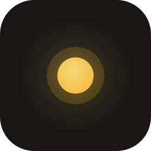
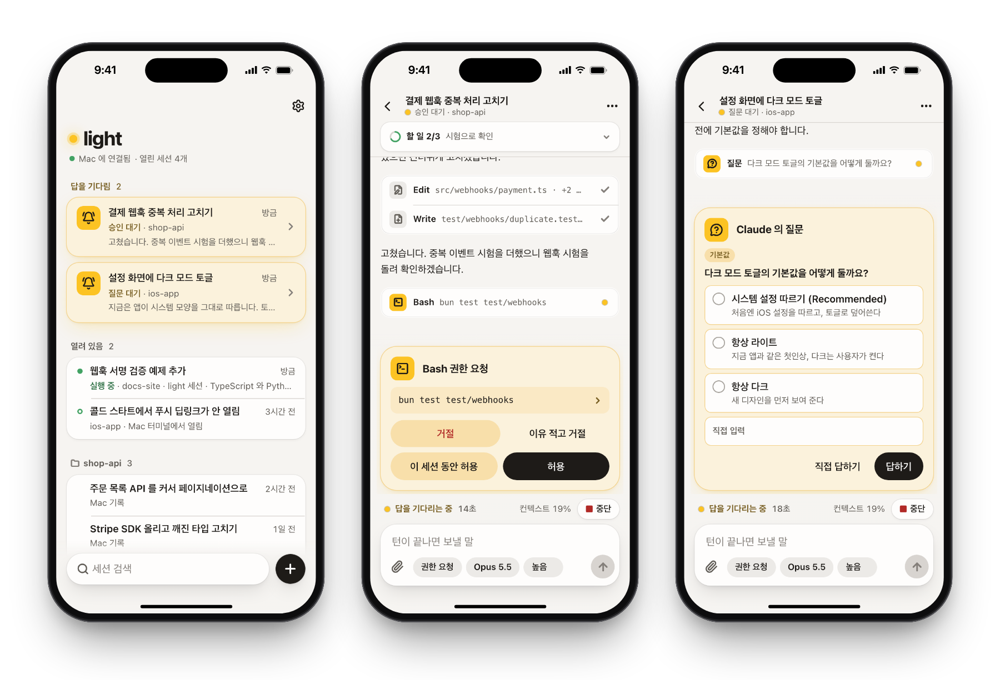
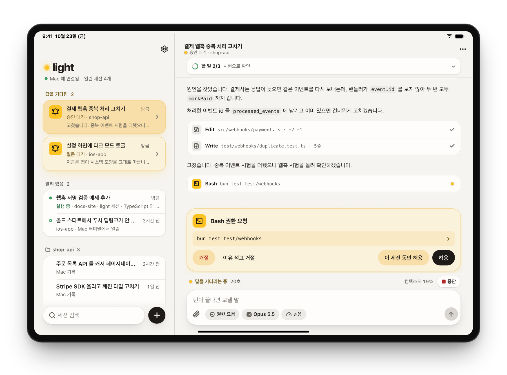
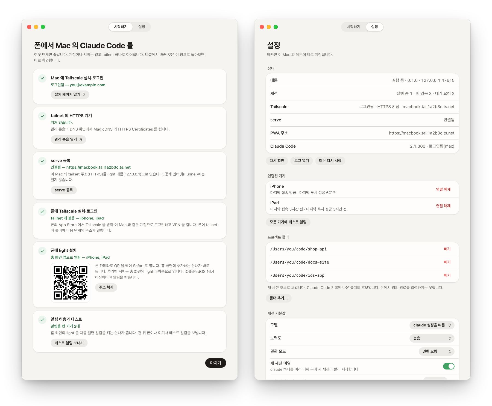
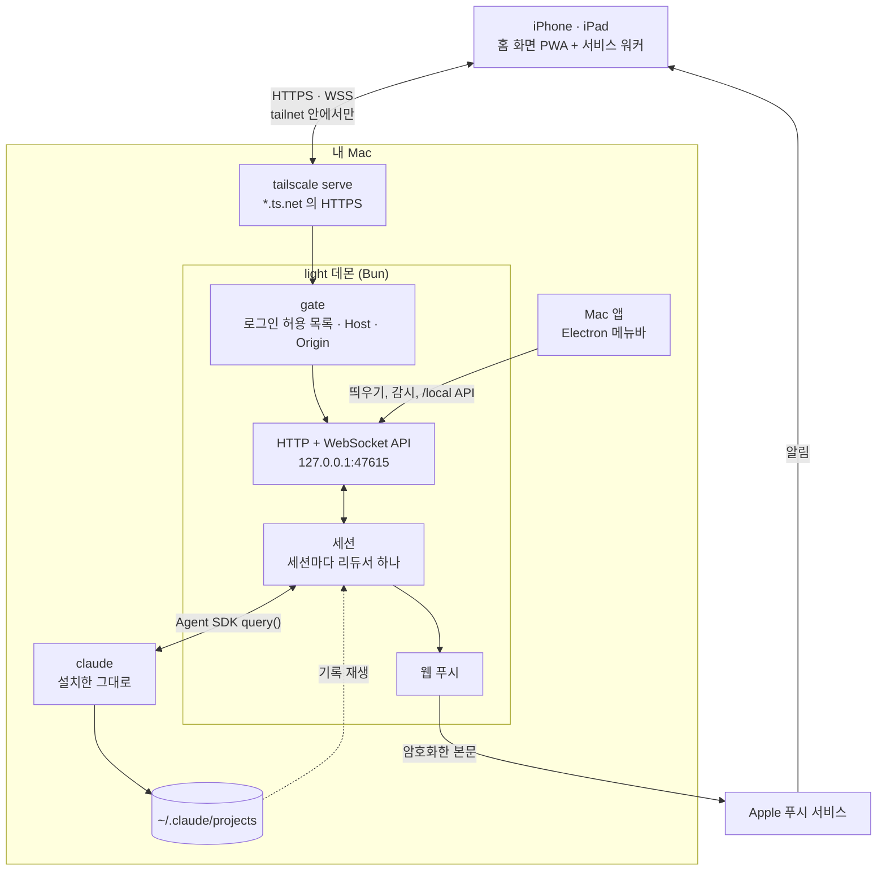
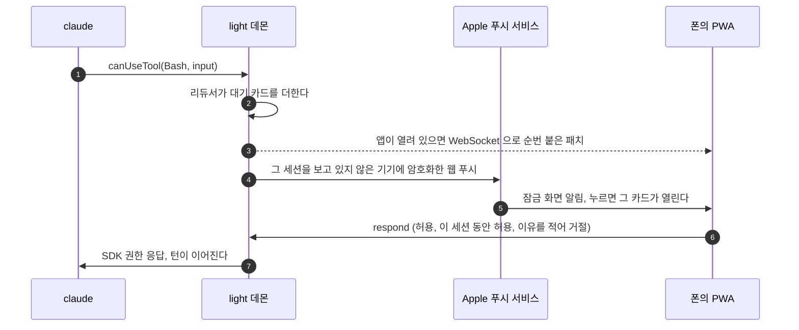

<div align="center">



# light

**Mac 에서 도는 Claude Code 세션을 아이폰·아이패드에서 시작하고 이어받고 승인합니다.**

중계 서버도 계정도 없습니다. 폰은 여러분의 [Tailscale](https://tailscale.com) tailnet 안에서만 Mac 에 닿습니다.

[](LICENSE)
[](https://github.com/ParkJin0318/light/actions/workflows/mac.yml)


[English](README.md) · 한국어

</div>

<picture>
  <source media="(prefers-color-scheme: dark)" srcset="docs/images/pwa-iphone-dark.png">
  
</picture>

Claude Code 는 몇 분씩 일하다가 멈춰서 묻습니다. 이 명령을 돌려도 되는지, 어느 쪽으로 할지, 이 계획이 맞는지. light 는 그 세션을 폰의 홈 화면 앱으로 옮깁니다. 세션이 답을 기다리면 잠금 화면에 알림이 오고 누르면 그 카드가 열립니다. 답하면 턴이 그대로 이어집니다. Mac 에는 메뉴바 앱 하나가 데몬을 띄워 둡니다.

> [!NOTE]
> 화면은 아직 한국어뿐입니다. 스크린샷은 데모 데이터로 찍었습니다.

## 기능

- **어느 세션과도 대화합니다.** 프로젝트 폴더를 골라 새 세션을 열거나 Mac 터미널에서 하던 세션을 엽니다. 응답은 흘려 보이고 도구 호출은 펼칠 수 있는 한 줄 카드로 줄입니다.
- **잠금 화면에서 승인합니다.** 권한 요청·질문·계획 승인이 웹 푸시로 오고 누르면 그 카드로 바로 열립니다. 한 번 허용, 이 세션 동안 허용, 거절, 이유를 적어 거절 가운데 고릅니다. 적은 이유는 Claude 에게 갑니다.
- **터미널 세션을 이어받습니다.** `~/.claude/projects` 의 기록을 훑어 고릅니다. 터미널에서 아직 열려 있으면 사본으로 이어 가거나 가져옵니다. 다시 터미널로 넘길 때는 붙여 넣을 `claude --resume` 명령을 줍니다.
- **터미널에서 쓰던 조작이 그대로 있습니다.** 권한 모드·모델·노력도·빠른 모드, 앞 메시지로 대화와 코드 되감기, 도는 명령을 백그라운드로 넘기기, `/btw` 곁가지 질문, 답의 일부를 인용해 묻기.
- **첨부.** 폰의 사진·스크린샷·파일을 붙입니다.
- **할 일 띠와 다음 단계 상자.** 세션마다 할 일 띠와 턴 끝의 답 단추 상자를 두고 그 요약을 알림 본문으로 씁니다. 끌 수 있습니다.
- **잠자기와 재시작을 견딥니다.** 데몬 재시작이나 Mac 잠자기로 끊긴 턴은 알아서 이어 가고 세션이 도는 동안은 Mac 을 깨워 둡니다.
- **아이폰과 아이패드에 맞춥니다.** 아이폰은 목록 → 채팅, 아이패드 가로는 2열이고 키보드 단축키(<kbd>⌘</kbd><kbd>[</kbd> / <kbd>⌘</kbd><kbd>]</kbd> 세션 이동, <kbd>⌥</kbd><kbd>N</kbd> 새 세션)가 있습니다. 라이트·다크 테마.

<picture>
  <source media="(prefers-color-scheme: dark)" srcset="docs/images/pwa-ipad-dark.png">
  
</picture>

## Mac 앱

메뉴바 앱이 데몬을 띄우고 죽으면 다시 띄웁니다. 메뉴에는 데몬·Tailscale·Claude Code 상태와 답을 기다리는 세션 수가 보입니다. 창에는 여섯 단계 시작하기와 설정이 있습니다.

<picture>
  <source media="(prefers-color-scheme: dark)" srcset="docs/images/mac-dark.png">
  
</picture>

## 요건

| 대상 | 요건 |
|---|---|
| Mac | macOS, [Bun](https://bun.sh) 1.3 이상, npm 이 딸린 Node.js, [Claude Code](https://code.claude.com) 설치·로그인 |
| 연결 | Mac 과 폰 모두 [Tailscale](https://tailscale.com) 에 같은 계정으로 로그인, tailnet 의 MagicDNS 와 HTTPS 인증서 켜기 |
| 폰 | iOS·iPadOS 16.4 이상. Safari 에서 홈 화면에 추가합니다(브라우저 탭으로 연 PWA 는 알림을 받지 못합니다) |

## 시작하기

Mac 앱은 [Releases](https://github.com/ParkJin0318/light/releases) 에 서명하지 않은 arm64 dmg 가 있습니다. 여는 법은 릴리스 노트에 있습니다. 응용 프로그램 폴더에 둔 light 는 스스로 업데이트합니다. 한 시간마다 최신 릴리스를 확인해 새 버전을 받아 대조해 두고, light 를 끌 때나 메뉴 막대의 「다시 시작해 업데이트」를 누를 때 바꿉니다. v0.1.0 에는 이 기능이 없어 다음 릴리스는 한 번 손으로 설치합니다. 소스에서 실행하려면 다음과 같습니다.

```sh
git clone https://github.com/ParkJin0318/light.git
cd light
npm install
npm run build   # PWA
npm run mac     # 메뉴바 앱 — 데몬을 띄우고 시작하기를 엽니다
```

시작하기는 여섯 단계이고 단계마다 끝났는지 바로 확인합니다.

1. Mac 에 Tailscale 을 설치하고 로그인합니다.
2. Tailscale 관리 콘솔에서 MagicDNS 와 HTTPS 인증서를 켭니다.
3. `tailscale serve` 를 등록합니다. 앱이 `tailscale serve --bg --https=443 http://127.0.0.1:47615` 를 실행해 데몬을 tailnet 에만 엽니다.
4. 폰에 Tailscale 을 설치하고 같은 계정으로 로그인합니다.
5. QR 을 찍어 Safari 로 열고 홈 화면에 추가합니다.
6. 홈 화면의 light 를 열어 알림을 허용하고 테스트 알림을 보냅니다.

데몬만 띄우려면 `sh scripts/dev-daemon.sh` 입니다. 데이터는 레포의 `.dev/` 에 둡니다. 이 Mac 의 브라우저로 `http://localhost:47615` 를 열면 같은 화면이 나옵니다.

### Mac 앱 빌드

`sh scripts/build-mac.sh` 가 PWA 를 짓고 데몬을 `bun build --compile` 로 실행 파일 하나로 묶어 Electron 앱에 함께 싣습니다.

| 변수 | 쓰임 |
|---|---|
| `LIGHT_BUNDLE_ID` | 번들 ID(기본 `dev.light.mac`) |
| `CSC_NAME` | Developer ID Application 인증서. `APPLE_ID`·`APPLE_APP_SPECIFIC_PASSWORD`·`APPLE_TEAM_ID` 까지 있으면 서명·공증하고 없으면 ad-hoc 서명 빌드를 만듭니다 |
| `TARGET` | `dmg`(기본) 또는 `dir` |
| `LIGHT_RELEASE_REPO` | 앱이 업데이트를 받을 릴리스의 `owner/name`. 이것을 주고 지은 빌드만 스스로 업데이트하고, 스크립트가 릴리스에 올릴 zip 과 `light-update.json` 도 남깁니다 |

CI([`.github/workflows/mac.yml`](.github/workflows/mac.yml))가 `release` 브랜치에 푸시할 때마다(손으로 돌릴 수도 있습니다) macOS 러너에서 같은 스크립트를 돌려 dmg 를 실행 결과에 올립니다. `release` 브랜치면 `mac/package.json` 의 버전을 태그로(`v0.1.0` 처럼) GitHub 릴리스도 냅니다. 릴리스에는 dmg 와 함께 설치본이 읽는 앱 zip 과 업데이트 명세 `light-update.json` 을 올립니다. 이미 릴리스가 있는 버전은 건너뛰니 새 릴리스는 버전을 올려서 냅니다. 러너가 Apple Silicon 이라 arm64 빌드만 나옵니다. CI 에서 서명·공증하려면 저장소 시크릿 `MAC_CERTIFICATE`(.p12 의 base64)·`MAC_CERTIFICATE_PASSWORD`·`MAC_CERTIFICATE_NAME`·`APPLE_ID`·`APPLE_APP_SPECIFIC_PASSWORD`·`APPLE_TEAM_ID` 를 둡니다. 없으면 ad-hoc 서명 빌드입니다.

## 작동 방식



데몬이 정본입니다. 세션마다 대화 리듀서를 돌리고 바뀐 항목만 순번 붙은 패치로 보냅니다. iOS 는 백그라운드 PWA 의 연결을 끊는데 앱이 앞으로 돌아오면 마지막으로 받은 순번 다음부터 다시 받습니다. 기록 재생과 실시간이 같은 리듀서를 지나서 둘이 똑같이 보입니다.

권한 요청·질문·계획 승인은 모두 SDK 의 `canUseTool` 로 데몬에 와서 폰의 카드가 되고 답은 SDK 응답으로 돌아갑니다.



### 레포 구조

```
light/
├── shared/src/         데몬과 PWA 가 함께 쓰는 순수 TypeScript
│   ├── protocol.ts     데몬 ↔ PWA 메시지(zod)
│   ├── settings.ts     설정 모델
│   └── session/        SDK 메시지 해석, 대화 리듀서, 대기 요청
├── daemon/src/         Bun 데몬
│   ├── main.ts         진입점
│   ├── server.ts       HTTP·WebSocket API, PWA 파일
│   ├── security.ts     요청 문지기
│   ├── session/        세션 수명, 권한 중계, 되감기, 자동 이어 가기
│   ├── claude/         ~/.claude 기록, 라이브 세션 레지스트리, 프로세스 띄우기
│   └── push/           웹 푸시(VAPID, aes128gcm)와 알릴 기기 고르기
├── pwa/                React + Vite 화면. 서비스 워커는 public/sw.js
├── mac/                Electron 메뉴바 앱. 창 화면은 ui/
└── scripts/            개발 데몬, Mac 앱 빌드, 아이콘 그리기, README 스크린샷
```

## 보안

- **경계는 tailnet 입니다.** 데몬은 `127.0.0.1` 에만 바인드하고 Mac 밖에서는 `tailscale serve` 를 거쳐야만 들어옵니다.
- **본인만 들어옵니다.** serve 가 붙이는 `Tailscale-User-Login` 을 허용 목록과 대조합니다. 기본값은 이 Mac 소유자의 로그인 하나입니다. 노드 공유로 들어온 다른 사용자와 태그 기기는 막습니다.
- **공개 인터넷에는 열지 않습니다.** Tailscale Funnel 이 켜져 있으면 데몬은 Mac 앱의 요청 말고는 모두 거절하고 Mac 앱이 이유를 보입니다.
- **브라우저 공격.** Host 허용 목록으로 DNS 리바인딩을, Origin 검사로 Mac 브라우저의 다른 사이트가 보내는 요청을 막습니다. Mac 앱의 로컬 API 는 데이터 폴더의 토큰(권한 `0600`)도 요구합니다.
- **위협 모델 밖:** 같은 Mac 의 다른 프로세스. 그 프로세스는 이미 `claude` 를 직접 돌릴 수 있습니다.
- **알림.** 웹 푸시 본문은 종단 간 암호화돼 Apple 이 읽지 못합니다. 잠금 화면에서 본문을 감추는 설정이 있습니다.
- **텔레메트리는 없습니다.** 로그는 `~/Library/Application Support/light/logs` 에만 남습니다.

## 인증

light 는 여러분이 설치한 `claude` 바이너리를 Agent SDK 로 수정 없이 띄우기만 합니다. OAuth 토큰과 키체인 자격 증명을 읽지도 저장하지도 넘기지도 않고 로그인 화면도 없습니다(로그인은 터미널의 `claude` 에서 합니다). 설치본 하나는 그 Mac 의 소유자 한 사람만 씁니다. 설정에서 로그인 셸의 `ANTHROPIC_API_KEY` 로 쓰는 길도 고를 수 있습니다.

## 알려진 한계

- 덮개를 닫으면 Mac 이 잠들어 세션이 멈춥니다. 앱은 세션이 도는 동안의 유휴 잠자기만 막습니다.
- Mac 이름이 바뀌면 `ts.net` 주소가 바뀌어 폰에서 다시 설치해야 합니다. Mac 앱이 알립니다.
- 터미널(PTY) 화면, 코드 뷰어, diff 뷰어, 병렬 worktree, Claude Code 외 에이전트는 다루지 않습니다.
- 화면은 한국어뿐입니다.
- Developer ID 인증서 없이 낸 릴리스는 ad-hoc 서명이라 업데이트마다 코드 서명이 바뀌어 macOS 가 폴더 접근 같은 권한을 다시 물을 수 있습니다. 화면 앞에 사람이 없는 Mac(서버로 쓰는 Mac mini 등)에서는 그 허용 창에 답할 사람이 없어 문서 폴더 같은 곳의 세션이 뜨지 못합니다. 데몬은 멈추지 않고 폰에 까닭을 알립니다. 시스템 설정 › 개인정보 보호 및 보안 › 전체 디스크 접근에서 light 를 켜 두십시오.

## 개발

```sh
bun test            # shared/·daemon/·mac/ 시험
npm run typecheck   # 워크스페이스 전부
npm run build       # PWA
npm run mac         # 개발 체크아웃으로 Mac 앱 실행
```

- 화면을 고쳤으면 PWA 를 빌드하고 개발 데몬(`.claude/launch.json`, 데이터는 `.dev/`)으로 확인합니다.
- `LIGHT_SMOKE=1 npm run mac` 은 Mac 앱을 띄워 데몬 상태를 찍고 끝납니다. `LIGHT_SMOKE_SHOT=<경로>` 는 창 스크린샷도 남기고 `LIGHT_SMOKE_CRASH=1` 은 데몬을 죽여 다시 뜨는지, `LIGHT_SMOKE_HANG=1` 은 데몬을 얼려 감시가 다시 띄우는지 봅니다.
- `LIGHT_HOME` 은 데이터 폴더를, `LIGHT_CLAUDE_HOME` 은 `~/.claude` 자리를 바꿉니다. 실제 `claude` 로 확인할 때는 Haiku 와 스크래치 폴더를 쓰고 `LIGHT_HOME` 을 따로 둡니다.
- Agent SDK 판은 `daemon/package.json` 에 고정합니다. 올리면 `shared/test/fixtures` 픽스처 시험과 실제 세션 확인을 다시 합니다.
- `sh scripts/screenshots.sh` 가 `docs/images/` 의 그림을 다시 만듭니다. `claude` 대신 각본대로 움직이는 데모 데몬을 47699 포트에 띄우고 Playwright 로 PWA 와 Mac 앱 창을 찍습니다. 처음 한 번은 `npx playwright install chromium` 을 먼저 돌립니다.

## 기여

이슈와 풀 리퀘스트를 환영합니다. light 는 한 사람이 매일 쓰려고 만드는 도구라 동작과 구조가 예고 없이 바뀔 수 있습니다. 큰 변경은 이슈로 먼저 이야기해 주세요. 풀 리퀘스트 전에 `bun test`·`npm run typecheck`·`npm run build` 를 돌려 주세요.

## 라이선스

[MIT](LICENSE) 입니다. light 는 Anthropic 이 만들거나 보증한 도구가 아닙니다. Claude 와 Claude Code 는 Anthropic 의 상표입니다.
