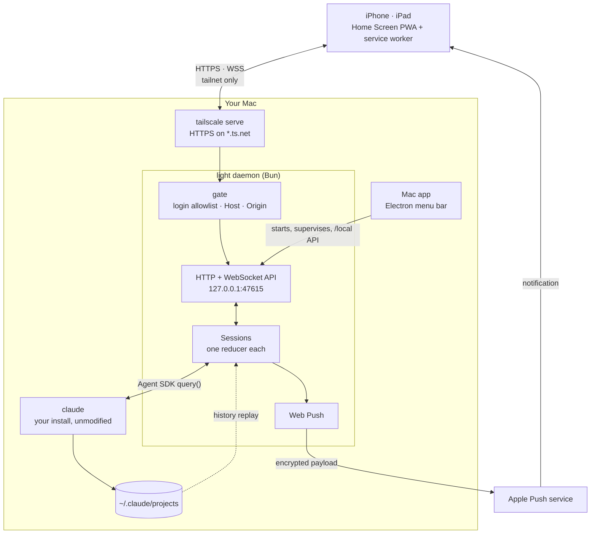
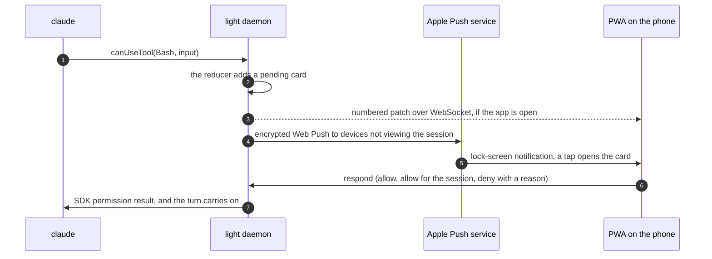

<div align="center">


# light

**Start, continue and approve the Claude Code sessions on your Mac — from your iPhone or iPad.**

No relay server and no account. Your phone reaches your Mac only inside your own [Tailscale](https://tailscale.com) tailnet.

[](LICENSE)
[](https://github.com/ParkJin0318/light/actions/workflows/mac.yml)


English · [한국어](README.ko.md)

</div>

<picture>
  <source media="(prefers-color-scheme: dark)" srcset="docs/images/pwa-iphone-dark.png">
  
</picture>

Claude Code works for minutes at a time and then stops to ask: can I run this command, which option do you want, does this plan look right. light puts those sessions in a home-screen app on your phone. When a session needs you, a notification lands on the lock screen; tap it, answer, and the turn carries on. A small menu bar app on the Mac runs the daemon that does the work.

> [!NOTE]
> The interface is in Korean only for now. The screenshots use demo data.

## Features

- **Chat with any session.** Start a new session in one of your project folders, or open one you started in the Mac terminal. Replies stream in, and tool calls fold into one-line cards you can expand.
- **Approvals on the lock screen.** Permission requests, questions and plan approvals arrive as Web Push notifications and open straight to the card. Allow once, allow for the session, deny, or deny with a reason Claude gets to read.
- **Pick up terminal sessions.** Browse the history in `~/.claude/projects`. If a session is still open in a terminal, continue it as a fork or take it over. Hand a session back with a ready-to-paste `claude --resume` command.
- **The controls you use in the terminal.** Permission mode, model, effort and fast mode; rewind the conversation and code to an earlier message; send a running command to the background; `/btw` side questions; quote part of a reply to ask about it.
- **Attachments.** Photos, screenshots and files from the phone.
- **Task list and next step.** Each session gets a task band and an end-of-turn box with reply buttons, and that summary becomes the notification text. It can be turned off.
- **Survives sleep and restarts.** Turns cut off by a daemon restart or Mac sleep are resumed automatically, and the Mac stays awake while sessions run.
- **Fits iPhone and iPad.** List and chat on iPhone; two columns on iPad in landscape, with keyboard shortcuts (<kbd>⌘</kbd><kbd>[</kbd> / <kbd>⌘</kbd><kbd>]</kbd> to switch sessions, <kbd>⌥</kbd><kbd>N</kbd> for a new one). Light and dark themes.

<picture>
  <source media="(prefers-color-scheme: dark)" srcset="docs/images/pwa-ipad-dark.png">
  
</picture>

## Mac app

The menu bar app starts the daemon, restarts it if it dies, and shows the daemon, Tailscale and Claude Code status with the number of sessions waiting on you. Its window holds a six-step setup and the settings.

<picture>
  <source media="(prefers-color-scheme: dark)" srcset="docs/images/mac-dark.png">
  
</picture>

## Requirements

| | |
|---|---|
| Mac | macOS, [Bun](https://bun.sh) 1.3 or later, Node.js with npm, and [Claude Code](https://code.claude.com) installed and signed in |
| Network | [Tailscale](https://tailscale.com) on the Mac and the phone, signed in to the same account, with MagicDNS and HTTPS certificates turned on for the tailnet |
| Phone | iOS or iPadOS 16.4 or later. Add light to the Home Screen from Safari; a PWA opened in a browser tab cannot receive notifications |

## Getting started

An unsigned arm64 dmg of the Mac app is on the [Releases](https://github.com/ParkJin0318/light/releases) page; the release notes say how to open it. To run from source instead:

```sh
git clone https://github.com/ParkJin0318/light.git
cd light
npm install
npm run build   # build the PWA
npm run mac     # start the menu bar app; it launches the daemon and opens setup
```

Setup walks through six steps and checks each one as you go:

1. Install Tailscale on the Mac and sign in.
2. Turn on MagicDNS and HTTPS certificates in the Tailscale admin console.
3. Register `tailscale serve`. The app runs `tailscale serve --bg --https=443 http://127.0.0.1:47615`, which exposes the daemon to your tailnet only.
4. Install Tailscale on the phone and sign in with the same account.
5. Scan the QR code, open it in Safari, and add light to the Home Screen.
6. Open light from the Home Screen, allow notifications, and send a test notification.

To run only the daemon, use `sh scripts/dev-daemon.sh`. It keeps its data in `.dev/` in the repo. Opening `http://localhost:47615` in a browser on the Mac shows the same app.

### Building the Mac app

`sh scripts/build-mac.sh` builds the PWA, compiles the daemon into a single executable with `bun build --compile`, and packages both into an Electron app.

| Variable | Purpose |
|---|---|
| `LIGHT_BUNDLE_ID` | Bundle ID (default `dev.light.mac`) |
| `CSC_NAME` | Developer ID Application certificate. With `APPLE_ID`, `APPLE_APP_SPECIFIC_PASSWORD` and `APPLE_TEAM_ID` the build is signed and notarized; without them it is unsigned |
| `TARGET` | `dmg` (default) or `dir` |

CI ([`.github/workflows/mac.yml`](.github/workflows/mac.yml)) runs the same script on a macOS runner for every push to the `release` branch (or when started by hand), and uploads the dmg to the workflow run. On the `release` branch it also publishes a GitHub release tagged with the version in `mac/package.json`, such as `v0.1.0`; a version that already has a release is skipped, so bump the version to ship a new one. The runner is Apple Silicon, so the build is arm64 only. To sign and notarize in CI, add the repository secrets `MAC_CERTIFICATE` (the .p12 in base64), `MAC_CERTIFICATE_PASSWORD`, `MAC_CERTIFICATE_NAME`, `APPLE_ID`, `APPLE_APP_SPECIFIC_PASSWORD` and `APPLE_TEAM_ID`; without them the build is unsigned.

## How it works



The daemon holds the truth. It runs one conversation reducer per session and sends only the items that changed, as numbered patches. iOS drops the sockets of a PWA in the background; when the app comes back, it picks up from the last number it saw. Replaying history and following a live session go through the same reducer, so both look the same.

Every permission prompt, question and plan approval reaches the daemon through the SDK's `canUseTool` callback, becomes a card on the phone, and the answer goes back as the SDK's response:



### Repository layout

```
light/
├── shared/src/         plain TypeScript shared by the daemon and the PWA
│   ├── protocol.ts     daemon ↔ PWA messages (zod)
│   ├── settings.ts     settings model
│   └── session/        SDK message parsing, conversation reducer, pending requests
├── daemon/src/         Bun daemon
│   ├── main.ts         entry point
│   ├── server.ts       HTTP and WebSocket API, PWA files
│   ├── security.ts     the request gate
│   ├── session/        session lifecycle, permission relay, rewind, auto-continue
│   ├── claude/         ~/.claude history, live-session registry, process spawn
│   └── push/           Web Push (VAPID, aes128gcm) and who to notify
├── pwa/                React + Vite screens; the service worker is public/sw.js
├── mac/                Electron menu bar app; the window UI is in ui/
└── scripts/            dev daemon, Mac app build, icon drawing, README screenshots
```

## Security

- **The tailnet is the boundary.** The daemon binds to `127.0.0.1` only. From outside the Mac, the only way in is `tailscale serve`.
- **Only you get in.** Requests through serve carry a `Tailscale-User-Login` header, which is checked against an allowlist; by default that is the Mac owner's login alone. Users who reach the Mac through node sharing, and tagged devices, are refused.
- **No public exposure.** If Tailscale Funnel is on, the daemon refuses all requests except the Mac app's, and the Mac app shows why.
- **Browser attacks.** A Host allowlist stops DNS rebinding, and an Origin check stops other sites in the Mac's browser from sending requests. The Mac app's local API also requires a token stored in the data folder with mode `0600`.
- **Out of scope:** other processes on the same Mac. They can already run `claude` directly.
- **Notifications.** Web Push payloads are encrypted end to end, so Apple cannot read them. A setting hides the message body on the lock screen.
- **No telemetry.** Logs stay in `~/Library/Application Support/light/logs`.

## Authentication

light starts the `claude` binary you installed, unmodified, through the Agent SDK. It never reads, stores or forwards OAuth tokens or Keychain credentials, and it has no sign-in screen; you sign in with `claude` in the terminal. One install serves one person, the owner of the Mac. In settings you can switch to the `ANTHROPIC_API_KEY` from your login shell instead.

## Known limitations

- Closing the lid puts the Mac to sleep and stops its sessions. The app only prevents idle sleep while sessions run.
- Renaming the Mac changes its `ts.net` address, so the phone has to install light again. The Mac app tells you when this happens.
- There is no terminal (PTY) view, code viewer, diff viewer, parallel worktrees, or support for agents other than Claude Code.
- The interface is in Korean only.

## Development

```sh
bun test            # tests for shared/ and daemon/
npm run typecheck   # every workspace
npm run build       # the PWA
npm run mac         # the Mac app against the dev checkout
```

- After changing a screen, build the PWA and check it against the dev daemon (`.claude/launch.json`, data in `.dev/`).
- `LIGHT_SMOKE=1 npm run mac` starts the Mac app, prints the daemon status and quits. `LIGHT_SMOKE_SHOT=<path>` also saves a screenshot of the window, and `LIGHT_SMOKE_CRASH=1` kills the daemon to check that it comes back.
- `LIGHT_HOME` moves the data folder and `LIGHT_CLAUDE_HOME` points at a different `~/.claude`. When testing against a real `claude`, use Haiku, a scratch folder and a separate `LIGHT_HOME`.
- The Agent SDK version is pinned in `daemon/package.json`. After bumping it, rerun the fixture tests in `shared/test/fixtures` and check a real session.
- `sh scripts/screenshots.sh` regenerates the images in `docs/images/`. It starts a demo daemon on port 47699 whose sessions follow a script instead of running `claude`, then captures the PWA and the Mac app window with Playwright. Run `npx playwright install chromium` once first.

## Contributing

Issues and pull requests are welcome. light is built for one person's daily use, so behavior and structure can change without notice; for anything large, open an issue first. Before sending a pull request, run `bun test`, `npm run typecheck` and `npm run build`.

## License

[MIT](LICENSE). light is not made or endorsed by Anthropic. Claude and Claude Code are trademarks of Anthropic.
